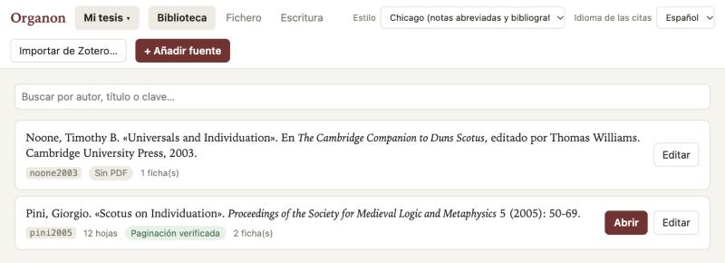
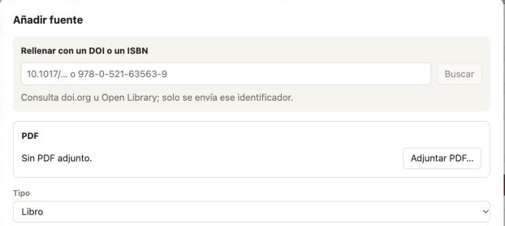
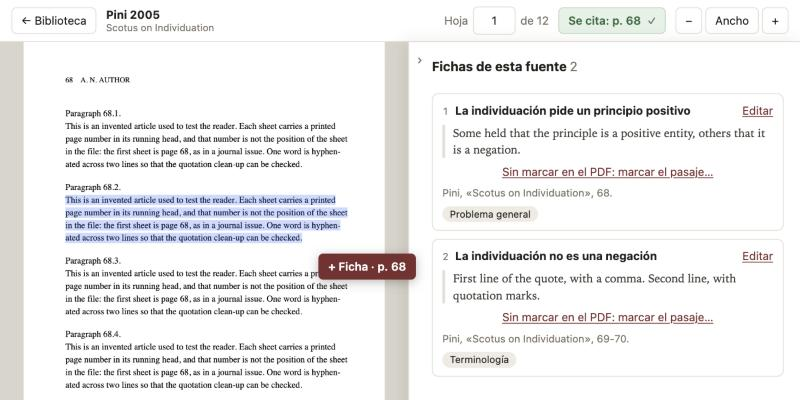
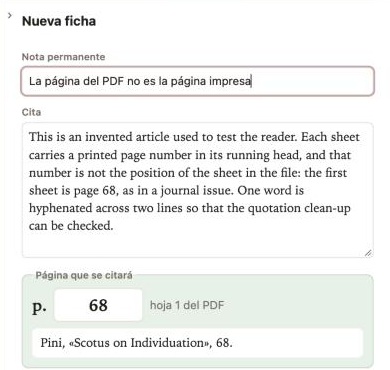
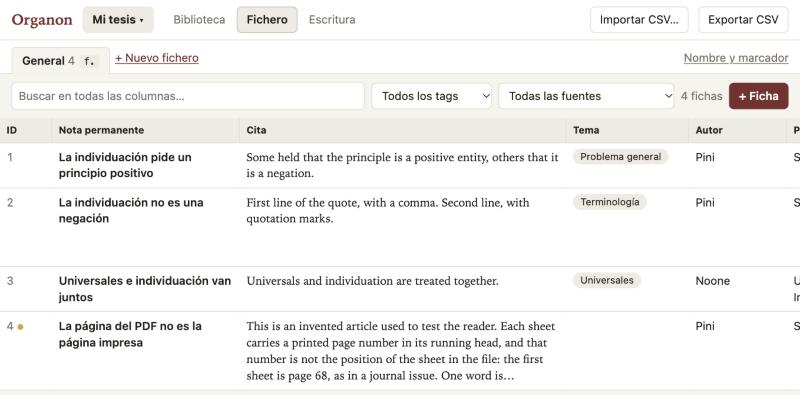
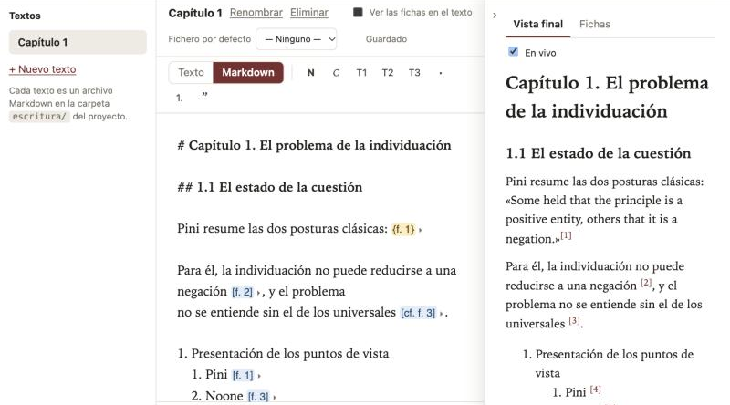
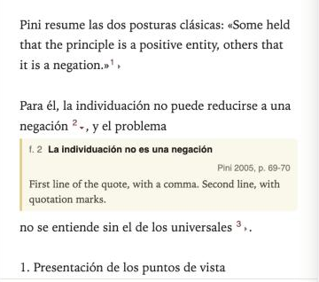

# Organon en cinco minutos

De un PDF a un capítulo con notas al pie, en seis pasos.

## 1. Abre un proyecto

Al abrir Organon, elige una carpeta: la de tu tesis, la de un trabajo final. Ahí se
guarda todo (fuentes, PDF, fichas y textos), en archivos que puedes abrir tú mismo.
Para cambiar de proyecto, pulsa su nombre arriba a la izquierda.

## 2. Añade una fuente y su PDF

Pulsa **+ Añadir fuente**. Pega un DOI o un ISBN y pulsa **Buscar**: Organon rellena
los datos. También puedes escribirlos a mano o traerlos de Zotero con **Importar de
Zotero…**. En el mismo formulario, **Adjuntar PDF…**

Al adjuntar el PDF, Organon deduce qué página impresa corresponde a cada hoja. Revisa
dos o tres hojas y confírmalo: así cada cita llevará la página correcta.

## 3. Lee y marca

Pulsa **Abrir** en la fuente. Selecciona un pasaje y pulsa **+ Ficha**: el botón ya
te dice qué página se citará.

Escribe la idea con tus palabras (la *nota permanente*), añade tags si quieres y
guarda.

## 4. Consulta tu fichero

En **Fichero** están todas tus fichas, numeradas, con búsqueda y filtros por tag y
por fuente. El número de cada ficha es el que usarás para citarla. ¿Ya tienes un
fichero en Google Sheets? **Importar CSV…**

## 5. Escribe citando tus fichas

En **Escritura**, crea un texto con **+ Nuevo texto**. Para citar la ficha 1:

- `{f. 1}` pone la cita en el texto, con su nota al pie.
- `[f. 1]` pone solo la nota al pie.

A la derecha, la **Vista final** muestra el texto con las notas numeradas y la
bibliografía. La pestaña **Fichas** busca fichas y las inserta por ti.

El botón **Texto** te deja escribir viendo el resultado; **Markdown**, la sintaxis
tal cual. La flechita junto a cada referencia despliega la ficha ahí mismo, sin
pegarla en el texto. Para hacer esquemas, usa Tab y Mayús+Tab en las listas.

## 6. Exporta

Arriba a la derecha, **Exportar**:

- **Word (.docx)**: con notas al pie de verdad, para entregar.
- **PDF**: el texto final, con las notas al final.
- **PDF con fichas**: tu texto tal como lo escribes, con cada ficha citada debajo. Para
  trabajar o para tu director.
- **Markdown**: el texto con las citas ya resueltas.

---

Más detalles (todas las formas de citar, dónde se guardan los datos): en el
[README](README.md).
